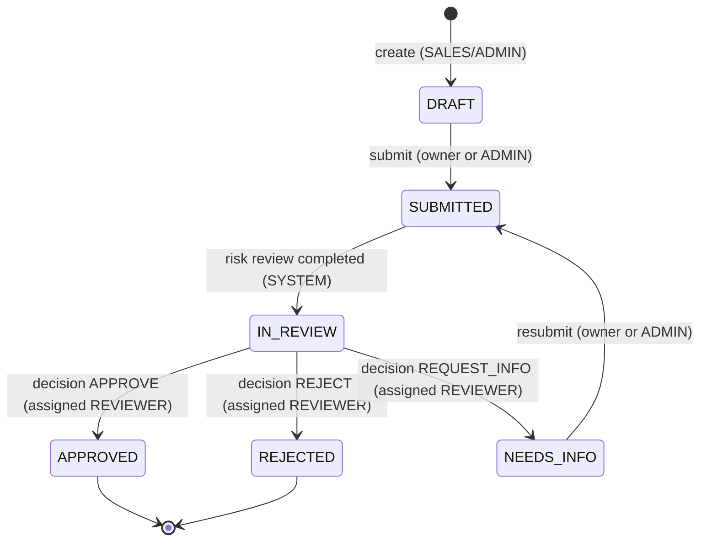

# Merchant Application Lifecycle — Implementation Guide (NestJS)

> **Audience:** the coding agent. Read this whole file before writing code.
> **Prerequisite:** `AGENT_SETUP_GUIDE.md` Phases 0–6 are complete and green (`npm run test:e2e` passes, login works, guards and `ApplicationPolicy` skeleton exist, Redis/Postgres run in Docker, the `risk-review` queue is registered).
> **Scope of this guide:** the merchant application domain, its state machine, the REST API, the asynchronous risk review (BullMQ), the audit trail, sensitive-data handling, and the tests that prove all of it.
> **Out of scope:** webhooks, MongoDB, ADR. Do not build them.

---

## 0. Rules of engagement (additions to the setup guide)

1. Every rule in the setup guide section 0 still applies.
2. **Pure logic first.** The state machine, policy, scoring rules, masking, and audit sanitizer are plain TypeScript with no Nest or DB imports. Write and unit-test them before any controller exists.
3. **One mutation pattern** (section 6): *lock → authorize → check state → mutate → audit → commit*. Every state-changing service method follows it. Do not invent variations.
4. **Never call the network (or the risk provider) while holding a DB transaction.**
5. **Never put personal data in Redis.** Job payloads contain ids only.
6. **Status codes are part of the contract** (section 4.3). Tests assert them.
7. Money is stored as **integer minor units** (cents). Never use floats.
8. Never interpolate user input into SQL or `ORDER BY`. Sort fields go through a whitelist map.
9. Implement in the priority order in section 11. If time runs short, drop COULD items first, then SHOULD items. Never drop a MUST.
10. Log every assumption you make in `docs/DECISIONS.md`.

---

## 1. Research summary: what real merchant-boarding systems do

This design is grounded in how payment platforms model onboarding. The sources are linked in section 14. Each row is a pattern we borrow.

| # | Pattern observed | Seen in | How we use it |
|---|------------------|---------|---------------|
| 1 | Two separate axes: the *process* state and the *verification* state. Adyen keeps a verification status (`pending`, `valid`, `invalid`, `rejected`) apart from whether a capability is allowed. | Adyen, Stripe (`requirements` + `disabled_reason`) | The assignment already asks for `status` and `riskStatus`. Keep them as **two independent fields**, never one merged enum. |
| 2 | **Fixable** outcomes are distinct from **final** ones. Adyen: `invalid` (fix and retry) vs `rejected` (final). Payabli: *Missing Data* / *Pending Documentation* vs *Declined*. | Adyen, Payabli | `NEEDS_INFO` (fixable, returns to the applicant) vs `REJECTED` (terminal). |
| 3 | An automated check does **not** equal approval. Flagged applications go to *Manual Review*. | Payrix, Payabli | The worker never approves. It records the risk result and moves the application to `IN_REVIEW`. Only the assigned reviewer decides. |
| 4 | Changing data triggers **re-verification**. | Adyen, Stripe | Editing in `NEEDS_INFO` and resubmitting creates a **new** risk review for the new submission. |
| 5 | Applicants can **save an incomplete application** and resume later. | Payabli | `DRAFT` status, editable until submitted. |
| 6 | Underwriting consumes standard business inputs: legal name, DBA, entity type, MCC, website, expected monthly volume, average and highest ticket, owner details. | Rainforest, Nuvei, Payabli, Payrix | Our application fields (section 3.2). |
| 7 | Results arrive **asynchronously**, and delivery is at-least-once, so consumers deduplicate by key. | Railway webhooks guide, BullMQ patterns | `jobId` deduplication **plus** a database unique constraint **plus** an idempotent worker. |
| 8 | After approval, real systems continue with *Boarding / Boarded* and can later restrict or disable accounts. | Payabli, Clearent, Stripe | Documented as future states (section 12). Not implemented. |
| 9 | Aggregate compliance can be derived from parts (a merchant is rejected if the business fails KYB or any beneficial owner fails KYC). Beneficial owners are anyone with ≥25% ownership. | GrailPay, Rainforest | Documented extension (section 12). We model one primary owner. |
| 10 | Decisions carry reasons, and audit trails exclude secrets and sensitive values. | Didit (`decision_reason_code`), OWASP | `comment` on decisions; allowlist-based audit sanitizer (section 8). |

---

## 2. Lifecycle design

### 2.1 Two axes

- **`status`** (workflow): where the application is in the human and process lifecycle.
- **`riskStatus`** (verification): what the automated risk review has concluded.

They change for different reasons and by different actors. `status` is changed by SALES/ADMIN (submit), the system (risk completed), and the assigned REVIEWER (decision). `riskStatus` is changed **only** by submit (to `PENDING`) and by the worker.

### 2.2 `status` values

| Status | Meaning | Editable? | Terminal? |
|--------|---------|-----------|-----------|
| `DRAFT` | Created, not yet submitted | yes | no |
| `SUBMITTED` | Locked; risk review queued or running | no | no |
| `IN_REVIEW` | Risk result persisted; awaiting the assigned reviewer's decision | no | no |
| `NEEDS_INFO` | Reviewer asked the applicant for more information | yes | no |
| `APPROVED` | Reviewer approved | no | **yes** |
| `REJECTED` | Reviewer rejected | no | **yes** |

### 2.3 `riskStatus` values

| Risk status | Meaning |
|-------------|---------|
| `NOT_STARTED` | Never submitted |
| `PENDING` | Submitted; risk review queued or running |
| `CLEAR` | Review finished with level `LOW` |
| `FLAGGED` | Review finished with level `MEDIUM` or `HIGH`; reviewer should look closely |
| `FAILED` | Review failed permanently or exhausted retries |

### 2.4 State diagram



Assignment of a reviewer does **not** change `status`. It is a separate action allowed in `SUBMITTED`, `IN_REVIEW`, and `NEEDS_INFO`.

### 2.5 Transition table (implement exactly this as data)

```ts
type Action = 'SUBMIT' | 'RISK_COMPLETED' | 'APPROVE' | 'REJECT' | 'REQUEST_INFO';

const TRANSITIONS: Record<ApplicationStatus, Partial<Record<Action, ApplicationStatus>>> = {
  DRAFT:      { SUBMIT: 'SUBMITTED' },
  SUBMITTED:  { RISK_COMPLETED: 'IN_REVIEW' },
  IN_REVIEW:  { APPROVE: 'APPROVED', REJECT: 'REJECTED', REQUEST_INFO: 'NEEDS_INFO' },
  NEEDS_INFO: { SUBMIT: 'SUBMITTED' },
  APPROVED:   {},
  REJECTED:   {},
};
const EDITABLE: ApplicationStatus[]   = ['DRAFT', 'NEEDS_INFO'];
const ASSIGNABLE: ApplicationStatus[] = ['SUBMITTED', 'IN_REVIEW', 'NEEDS_INFO'];
```

The state machine is a pure module exposing `nextStatus(from, action)`, `assertTransition(from, action)` (throws `InvalidStateTransitionException`), `isEditable(status)`, and `isAssignable(status)`.

### 2.6 Invariants (tests must protect these)

- **I1.** `status = IN_REVIEW` implies `riskStatus ∈ {CLEAR, FLAGGED}` and a `COMPLETED` risk review exists for the current `submission_number`. This is why decisions can never be made without a persisted risk result.
- **I2.** At most one risk review per `(application_id, submission_number)`, enforced by a DB unique constraint.
- **I3.** `APPROVED` and `REJECTED` are immutable: no edit, no assign, no further decision.
- **I4.** Every state change writes an audit row **in the same transaction**.
- **I5.** `assigned_reviewer_id`, when set, referenced a user with role `REVIEWER` at assignment time.
- **I6.** `riskStatus` is never writable through any API DTO.
- **I7.** `submission_count` increments exactly once per successful submit.

---

## 3. Domain model

### 3.1 Tables

`users` exists already. Add four tables in **one reviewed migration per table or one combined migration** (your choice; each has a working `down`).

**`merchant_applications`**

| Column | Type | Notes |
|--------|------|-------|
| `id` | uuid PK | `gen_random_uuid()` |
| `business_name` | varchar(120) | trade / DBA name |
| `legal_business_name` | varchar(200) | |
| `business_type` | enum `business_type` | `SOLE_PROPRIETORSHIP, PARTNERSHIP, LLC, CORPORATION, NON_PROFIT` |
| `mcc` | char(4) | merchant category code |
| `website` | varchar(255) null | |
| `business_tax_id` | varchar(20) null | **sensitive**, write-only |
| `owner_first_name`, `owner_last_name` | varchar(80) | |
| `owner_email` | varchar(254) | lowercased |
| `owner_phone` | varchar(20) | E.164 |
| `owner_date_of_birth` | date null | **sensitive**, write-only |
| `expected_monthly_volume` | bigint | minor units |
| `average_ticket_size` | bigint | minor units |
| `highest_ticket_size` | bigint | minor units |
| `currency` | char(3) | ISO 4217, default `USD` |
| `status` | enum `application_status` | default `DRAFT` |
| `risk_status` | enum `risk_status` | default `NOT_STARTED` |
| `submission_count` | int | default 0 |
| `created_by_id` | uuid FK → users | set server-side, never from input |
| `assigned_reviewer_id` | uuid FK → users, null | |
| `submitted_at` | timestamptz null | last submission time |
| `decided_at` | timestamptz null | set on APPROVED/REJECTED |
| `created_at`, `updated_at` | timestamptz | |

Check constraints: `highest_ticket_size >= average_ticket_size`, all three money columns `> 0`, `submission_count >= 0`.

**`risk_reviews`** (one per submission)

| Column | Type | Notes |
|--------|------|-------|
| `id` | uuid PK | |
| `application_id` | uuid FK | |
| `submission_number` | int | |
| `status` | enum `risk_review_status` | `PENDING, PROCESSING, COMPLETED, FAILED` |
| `risk_level` | enum null | `LOW, MEDIUM, HIGH` |
| `risk_score` | int null | 0–100 |
| `flags` | jsonb | array of reason codes, default `[]` |
| `provider_reference` | varchar null | simulated third-party id |
| `attempts` | int | default 0, incremented at each processing start |
| `last_error` | text null | sanitized message, no payloads |
| `enqueued_at` | timestamptz null | set after a successful `queue.add` |
| `started_at`, `completed_at` | timestamptz null | |
| `created_at`, `updated_at` | timestamptz | |

**`UNIQUE (application_id, submission_number)`**. This is the idempotency anchor.

**`review_decisions`** (append-only history)

`id`, `application_id` FK, `submission_number` int, `reviewer_id` FK → users, `decision` enum (`APPROVE, REJECT, REQUEST_INFO`), `comment` text null, `created_at`.

**`audit_logs`** (append-only, section 8)

### 3.2 Indexes (each one justified in a migration comment)

- `merchant_applications (status)`: filter by status.
- `merchant_applications (created_by_id, status)`: SALES scoping plus filter.
- `merchant_applications (assigned_reviewer_id, status)`: reviewer queue.
- `merchant_applications (created_at DESC, id DESC)`: stable pagination order.
- `risk_reviews`: the unique constraint is the index.
- `review_decisions (application_id, created_at)`.
- `audit_logs (entity_type, entity_id, occurred_at)` and `(actor_id)`.

### 3.3 Entity pitfalls (read carefully)

- Postgres returns `bigint` as a **string**. Add a `ColumnNumericTransformer` (string ↔ number) on the three money columns. Values stay within JS safe-integer range; add a DTO max of `9_000_000_000_000` minor units.
- Use `@Column({ type: 'timestamptz' })` for all timestamps.
- Never load relations in a query that takes a row lock (section 6).
- Map flat columns to nested API shapes (`owner`, `processing`) in `mappers/application.mapper.ts`. Controllers never return entities.

---

## 4. Authorization for the domain

The three-layer model from the setup guide (section 9.1) applies. Extend `ApplicationPolicy` with the actions below.

### 4.1 Who can do what, in which state

| Action | Who (layer 2 role + layer 3 object rule) | Allowed `status` | Wrong state → |
|--------|------------------------------------------|------------------|---------------|
| Create | SALES, ADMIN | n/a | n/a |
| View / list | ADMIN all; REVIEWER all; SALES only `created_by_id = me` | any | n/a |
| Update | SALES (own only), ADMIN | `DRAFT`, `NEEDS_INFO` | 409 `APPLICATION_NOT_EDITABLE` |
| Submit | SALES (own only), ADMIN | `DRAFT`, `NEEDS_INFO` | 409 `INVALID_STATE_TRANSITION` |
| Assign reviewer | ADMIN | `SUBMITTED`, `IN_REVIEW`, `NEEDS_INFO` | 409 `INVALID_STATE_TRANSITION` |
| Record decision | REVIEWER **and** `assigned_reviewer_id = me`. **ADMIN cannot.** | `IN_REVIEW` | 409 `INVALID_STATE_TRANSITION` |
| Risk completed | SYSTEM (worker) | `SUBMITTED` | no-op, logged |

### 4.2 Check order (fixed; tests assert it)

1. **Authentication** → 401.
2. **Role gate** (`@Roles`) → 403.
3. **Load with visibility scope** (SALES: `id AND created_by_id`) → not found → **404**.
4. **Object-level policy** (e.g. assigned reviewer) → **403**.
5. **State check** (state machine) → **409**.
6. **Business-input validation** (e.g. reviewer eligibility, required comment) → **400**.

Consequence: a non-assigned REVIEWER attempting a decision on a `SUBMITTED` application gets **403** (step 4), not 409. A SALES user poking another user's application gets **404** at every endpoint.

### 4.3 Status code contract

| Code | Used for |
|------|----------|
| 200 | successful read, update, assign |
| 201 | create application; record decision |
| 202 | submit (async processing started) |
| 400 | validation failure, unknown/extra fields, ineligible reviewer, missing required comment |
| 401 | missing/invalid token |
| 403 | wrong role, or not the assigned reviewer |
| 404 | not found, **or** SALES requesting another user's application |
| 409 | invalid state transition, not editable, duplicate action lost a race |

Error body adds a machine-readable `code` (extend the global exception filter): `INVALID_STATE_TRANSITION`, `APPLICATION_NOT_EDITABLE`, `REVIEWER_NOT_ELIGIBLE`, `COMMENT_REQUIRED`. Create `DomainException(code, httpStatus, message)` in `common/errors/` and subclasses for each. The filter maps them.

```json
{
  "statusCode": 409,
  "error": "Conflict",
  "code": "INVALID_STATE_TRANSITION",
  "message": "Cannot SUBMIT an application in status IN_REVIEW",
  "path": "/applications/3f0c.../submit",
  "timestamp": "2026-10-11T10:00:00.000Z"
}
```

---

## 5. API contract

All routes require a Bearer token. Add `@ApiTags('applications')`, `@ApiBearerAuth()`, and `@ApiOkResponse` / `@ApiNotFoundResponse` / `@ApiConflictResponse` etc. on every handler. Every DTO property has `@ApiProperty` with an example.

### 5.1 Endpoints

| Method + path | Roles | Description |
|---------------|-------|-------------|
| `POST /applications` | SALES, ADMIN | Create a `DRAFT`. |
| `GET /applications` | all | List, scoped by role. Query: `status`, `riskStatus`, `assignedReviewerId`, `page`, `limit`, `sort`, `order`. |
| `GET /applications/:id` | all | Detail, scoped. Includes latest risk review summary and latest decision summary. |
| `PATCH /applications/:id` | SALES, ADMIN | Partial update while `DRAFT` / `NEEDS_INFO`. |
| `POST /applications/:id/submit` | SALES, ADMIN | Lock the application and enqueue risk review. Returns **202**. |
| `POST /applications/:id/assign` | ADMIN | Body `{ reviewerId }`. |
| `POST /applications/:id/decisions` | REVIEWER | Body `{ decision, comment? }`. Returns **201**. |
| `GET /applications/:id/decisions` | all (same visibility as the application) | Decision history. |
| `GET /audit-logs` | ADMIN | Filter by `entityId`, `action`, `actorId`; paginated. (SHOULD) |
| `POST /applications/:id/risk-review/retry` | ADMIN | Re-run a `FAILED` risk review. (COULD) |

### 5.2 Create request

```json
{
  "businessName": "Everest Coffee",
  "legalBusinessName": "Everest Coffee Roasters Pvt Ltd",
  "businessType": "CORPORATION",
  "mcc": "5499",
  "website": "https://example.com",
  "businessTaxId": "000000001",
  "owner": {
    "firstName": "Test",
    "lastName": "Owner",
    "email": "owner@example.com",
    "phone": "+9779800000000",
    "dateOfBirth": "1990-01-15"
  },
  "processing": {
    "expectedMonthlyVolume": 2500000,
    "averageTicketSize": 4500,
    "highestTicketSize": 20000,
    "currency": "USD"
  }
}
```

All values in examples, seeds, and tests are **obviously fake** (`example.com`, zero-filled ids).

### 5.3 DTO validation rules

- `businessName` 2–120, `legalBusinessName` 2–200 (trim).
- `businessType` enum. `mcc` matches `^\d{4}$`.
- `website` optional, `@IsUrl({ protocols: ['http','https'], require_protocol: true })`.
- `businessTaxId` optional, `^\d{9}$`.
- `owner.email` valid email, lowercased in a `@Transform`. `owner.phone` matches `^\+[1-9]\d{6,14}$`. `owner.dateOfBirth` optional ISO date, in the past, age ≥ 18.
- `processing.*` integers, `> 0`, `<= 9_000_000_000_000`. `currency` matches `^[A-Z]{3}$`, default `USD`.
- Cross-field rules (enforced in the service on the **merged** result, so PATCH cannot violate them): `highestTicketSize >= averageTicketSize` and `expectedMonthlyVolume >= averageTicketSize`.
- Nested objects use `@ValidateNested()` + `@Type()`.
- **PATCH** accepts any subset of top-level fields and any subset of `owner` / `processing` fields. Build nested partial DTOs with `PartialType` from `@nestjs/swagger`.
- **Forbidden in any create/update DTO** (global `forbidNonWhitelisted` rejects them): `id`, `status`, `riskStatus`, `submissionCount`, `createdById`, `assignedReviewerId`, timestamps.

Decision DTO:
- `decision`: `APPROVE | REJECT | REQUEST_INFO`.
- `comment`: 10–2000 chars. **Required** for `REJECT` and `REQUEST_INFO` (else 400 `COMMENT_REQUIRED`). **Also required for `APPROVE` when the latest risk level is `HIGH`** (override needs justification).

### 5.4 Responses

- List items: `id, businessName, legalBusinessName, status, riskStatus, assignedReviewerId, createdById, submittedAt, createdAt, updatedAt`.
- Detail adds `businessType, mcc, website, owner{firstName,lastName,email,phone}, processing{...}, businessTaxIdMasked, risk{status, level, score, flags, completedAt}, latestDecision{decision, comment, reviewerId, createdAt}`.
- **Write-only sensitive fields:** `businessTaxId` is returned only as `businessTaxIdMasked` (e.g. `*****0001`). `ownerDateOfBirth` is never returned.
- Never return an entity, `passwordHash`, or internal columns.

### 5.5 Pagination, filtering, sorting

- Offset pagination: `page` (default 1, min 1), `limit` (default 20, **max 100**, else 400).
- Response: `{ items, meta: { page, limit, total, totalPages } }`.
- `status` / `riskStatus` validated against enums (invalid → 400).
- `sort` ∈ `createdAt | updatedAt | submittedAt` through a **whitelist map to column names**; `order` ∈ `ASC | DESC`. Default `createdAt DESC`, with `id DESC` as the tiebreaker.
- The visibility scope (SALES → own) is applied **before** any client filter and cannot be widened. Unknown query params → 400.
- Use `getManyAndCount()`.

---

## 6. Transactions and concurrency: one pattern

Every mutating service method does exactly this, inside one `dataSource.transaction`:

```
1. LOCK     load the application row with pessimistic_write (SELECT ... FOR UPDATE),
            applying the visibility scope (SALES: AND created_by_id = :me). Not found → 404.
2. AUTHZ    ApplicationPolicy check → 403.
3. STATE    state machine / editable / assignable check → 409.
4. VALIDATE business inputs (reviewer eligibility, comment rules, cross-field rules) → 400.
5. MUTATE   update the application (+ insert decision / risk_review rows).
6. AUDIT    insert the audit row with the same EntityManager.
7. COMMIT
```

Why: two concurrent submits (or decisions) serialize on the row lock. The loser then sees the new state and fails the state check with 409, so there is no double submit, no double risk review, and no double decision.

Pitfalls:
- TypeORM requires a transaction for pessimistic locks, and Postgres rejects `FOR UPDATE` on the nullable side of an outer join. **Load the locked row without relations**; fetch related data in separate queries.
- Pass the transaction's `EntityManager` to the audit service and every repository call inside the transaction.
- Enqueueing to BullMQ happens **after commit** (section 7.4).

---

## 7. Asynchronous risk review

### 7.1 Flow

```mermaid
sequenceDiagram
    participant C as Client (SALES)
    participant A as API
    participant DB as Postgres
    participant Q as BullMQ (Redis)
    participant W as Worker
    participant P as Risk provider (simulated)
    C->>A: POST /applications/:id/submit
    A->>DB: TX: lock, check, status=SUBMITTED, riskStatus=PENDING,<br/>submission_count+1, insert risk_review(PENDING), audit
    A->>Q: add(job, jobId = risk-review-{appId}-{n}) after commit
    A->>DB: set enqueued_at
    A-->>C: 202 Accepted
    Q->>W: deliver job (at-least-once)
    W->>DB: load review; skip if COMPLETED or stale
    W->>DB: mark PROCESSING, attempts+1
    W->>P: assess() (no DB transaction open)
    W->>DB: TX: lock app, persist result, status=IN_REVIEW, riskStatus=CLEAR/FLAGGED, audit
```

### 7.2 Job identity and payload

- Queue: `risk-review`. Job name: `assess`.
- **`jobId = risk-review-${applicationId}-${submissionNumber}`**. Use hyphens. Avoid `:`; BullMQ rejects it in recent versions (verify against the installed version).
- Why `submissionNumber` is in the id: BullMQ refuses a second job with an existing `jobId` while the first is queued, active, or retained after completion. Using only the application id would silently drop the resubmission after `NEEDS_INFO`.
- **Payload: `{ applicationId, submissionNumber, riskReviewId }` only.** No names, emails, tax ids, or amounts. The worker loads data from Postgres.
- Job options (all from env, with defaults): `attempts: 5` (total tries including the first), `backoff: { type: 'exponential', delay: 2000 }` (waits roughly 2s, 4s, 8s, 16s), `removeOnComplete: { age: 86400, count: 1000 }`, `removeOnFail: false`.
- Worker concurrency from env (default 5).
- Test overrides: tiny backoff (10 ms).

### 7.3 Provider abstraction

```ts
export const RISK_PROVIDER = Symbol('RISK_PROVIDER');
export interface RiskProvider {
  assess(input: RiskAssessmentInput): Promise<RiskAssessment>;
}
export class RiskProviderTransientError extends Error {}   // retry
export class RiskProviderPermanentError extends Error {}   // do not retry
```

- `RiskAssessmentInput` is a **minimal projection** (mcc, businessType, hasWebsite, expectedMonthlyVolume, averageTicketSize, highestTicketSize, currency). No personal data.
- `SimulatedRiskProvider` (default binding): waits `RISK_PROVIDER_LATENCY_MS`, randomly throws `RiskProviderTransientError` at `RISK_PROVIDER_FAILURE_RATE` (inject the RNG so tests can control it), then returns a deterministic assessment from `scoreRisk()`. Document clearly that this simulates a third-party KYB/risk vendor.
- Tests replace the provider with `overrideProvider(RISK_PROVIDER).useValue(fake)`. **Do not** put magic strings in production code to force failures.

**`scoreRisk()` (pure function, unit-tested):**

| Rule | Points |
|------|--------|
| base | +10 |
| MCC in `{7995, 5967, 6051, 4829}` (illustrative high-risk set; document that it is a toy list) | +40 |
| `expectedMonthlyVolume > 5_000_000` (≥ $50,000) | +20 |
| `highestTicketSize > 10 × averageTicketSize` | +15 |
| no website | +10 |

Cap at 100. Level: `< 30` → `LOW`, `30–59` → `MEDIUM`, `>= 60` → `HIGH`. Flags are the codes of the rules that fired (`HIGH_RISK_MCC`, `HIGH_VOLUME`, `TICKET_SPREAD`, `NO_WEBSITE`). `providerReference` is a random uuid. Mapping: `LOW` → `riskStatus CLEAR`; `MEDIUM`/`HIGH` → `FLAGGED`.

### 7.4 Producing the job (submit)

1. Run the transaction from section 6: state `SUBMITTED`, `risk_status PENDING`, `submission_count + 1`, `submitted_at = now()`, insert `risk_reviews` row `(application_id, submission_count, PENDING)`, audit `APPLICATION_SUBMITTED`.
2. **After commit**, `queue.add('assess', payload, { jobId, ...options })`, then `UPDATE risk_reviews SET enqueued_at = now()`.
   Why after commit: if the job were enqueued inside the transaction, the worker could run before the data is visible.
3. If `queue.add` throws: log the error (no payload), **still return 202**. The application is durably `SUBMITTED` and a recovery step will enqueue it.
4. **`RiskReviewRecoveryService`** (`OnApplicationBootstrap`): find `risk_reviews` with `status = PENDING AND enqueued_at IS NULL` and enqueue them. Safe to repeat because of the `jobId`.
5. README trade-off note: the production-grade fix is a **transactional outbox**; this take-home uses enqueue-after-commit plus startup recovery.

### 7.5 Worker algorithm (idempotent; read every step)

BullMQ delivers **at least once**. A job can run twice (stall, crash, duplicate). `jobId` deduplication only prevents duplicate *enqueues*; it does not protect against a job that crashes halfway and is retried. The worker must therefore be safe to run repeatedly.

`process(job)`:

1. Load the `risk_reviews` row by `riskReviewId`. Missing → throw `UnrecoverableError` (data bug, never retry).
2. **If `status = COMPLETED` → return.** This is idempotency step one: a redelivered job does nothing.
3. Load the application (plain read). If `application.submission_count !== job.data.submissionNumber` (stale job from an earlier submission) or `application.status !== 'SUBMITTED'` → log and return. Do not touch anything.
4. `UPDATE risk_reviews SET status='PROCESSING', attempts = attempts + 1, started_at = coalesce(started_at, now()) WHERE id = :id AND status IN ('PENDING','PROCESSING')`.
5. Call `provider.assess()`. **No transaction is open here.**
6. In one transaction (section 6 pattern, actor = `SYSTEM`):
   - lock the `risk_reviews` row; if it is now `COMPLETED`, return (another delivery won);
   - lock the application row; re-check `status = 'SUBMITTED'` and `submission_count` still matches; otherwise return;
   - persist the result on `risk_reviews` (`COMPLETED`, level, score, flags, provider reference, `completed_at`);
   - update the application: `status = IN_REVIEW`, `risk_status = CLEAR | FLAGGED`;
   - insert audit `RISK_REVIEW_COMPLETED`.
7. Error handling:
   - `RiskProviderTransientError` (or any unexpected error): rethrow so BullMQ retries with backoff. Store a sanitized `last_error`.
   - `RiskProviderPermanentError`: throw `UnrecoverableError` so BullMQ skips the remaining attempts.

**Final failure.** Handle it in `@OnWorkerEvent('failed')`: treat it as final when `err instanceof UnrecoverableError` or `job.attemptsMade >= (job.opts.attempts ?? 1)`. Then, in a transaction: if the review is not already `COMPLETED` or `FAILED`, set review `FAILED`, set application `risk_status = FAILED` (status stays `SUBMITTED`), and insert audit `RISK_REVIEW_FAILED`. The handler is idempotent. **Verify the `attemptsMade` semantics against the installed BullMQ version with a test** that proves the handler fires exactly once after the last attempt. If your test shows an off-by-one, fix the condition.

What happens to a `FAILED` application: it stays `SUBMITTED` with `riskStatus FAILED`. Reviewers cannot decide on it (it is not `IN_REVIEW`). ADMIN recovery is the COULD retry endpoint (section 11). Document this behaviour in the README.

**Retry endpoint design (COULD):** add a `run` int column to `risk_reviews` (default 1), include it in the `jobId` (`...-${submissionNumber}-r${run}`), reset the review to `PENDING`, set `risk_status PENDING`, audit `RISK_REVIEW_RETRIED`, enqueue after commit.

---

## 8. Audit trail and sensitive data

### 8.1 `audit_logs` table

| Column | Type | Notes |
|--------|------|-------|
| `id` | uuid PK | |
| `occurred_at` | timestamptz | default `now()` |
| `actor_type` | enum `USER`, `SYSTEM` | |
| `actor_id` | uuid null FK → users (RESTRICT) | null for SYSTEM |
| `actor_role` | varchar null | snapshot of the role at the time |
| `action` | varchar(64) | constant from `audit.actions.ts` |
| `entity_type` | varchar(64) | e.g. `merchant_application` |
| `entity_id` | uuid | **no FK**, so audit rows survive any entity change |
| `before` | jsonb null | sanitized |
| `after` | jsonb null | sanitized |
| `metadata` | jsonb | e.g. `{ requestId, submissionNumber }`. No personal data. |

### 8.2 Actions to record

MUST: `APPLICATION_CREATED`, `REVIEWER_ASSIGNED`, `DECISION_RECORDED`.
SHOULD: `APPLICATION_UPDATED`, `APPLICATION_SUBMITTED`, `RISK_REVIEW_COMPLETED`, `RISK_REVIEW_FAILED`.
COULD: `RISK_REVIEW_RETRIED`, `AUTH_LOGIN_FAILED` (log the fact and a masked identifier only).

`AuditService.record(manager, { actor, action, entityType, entityId, before?, after?, metadata? })`. It accepts the **transaction's `EntityManager`** so the audit row commits or rolls back with the change (invariant I4). The service exposes **no update or delete method**.

`Actor` type: `{ type: 'USER', id, role } | { type: 'SYSTEM' }`. Service methods take an `ActorContext` (`{ actor, requestId? }`), never the raw request.

### 8.3 Sanitizer and masking (pure, unit-tested)

`common/masking/masking.ts`:

```ts
maskTaxId('000000001')        // '*****0001'
maskEmail('owner@example.com') // 'o***@example.com'
maskPhone('+9779800000000')    // '*********0000'
```

`audit/audit-sanitizer.ts`: **allowlist-based**.
- Only fields in an explicit allowlist per entity type are recorded. Unknown fields are dropped (deny by default).
- Sensitive fields: `businessTaxId`, `ownerDateOfBirth` are replaced with `"[REDACTED]"`; email and phone are masked.
- A global key blocklist (`password`, `passwordHash`, `token`, `accessToken`, `secret`, `authorization`, `cookie`) is stripped at any depth as a second safety net.
- For updates, record `changedFields` (names) and before/after values for **non-sensitive** fields only; for sensitive fields record only that they changed.

Use the same masking functions for: API responses (`businessTaxIdMasked`), the audit sanitizer, and the pino redaction config.

### 8.4 Append-only enforcement (SHOULD)

In the audit migration, add a trigger so even raw SQL cannot alter history:

```sql
CREATE FUNCTION audit_logs_block_mutation() RETURNS trigger AS $$
BEGIN RAISE EXCEPTION 'audit_logs is append-only'; END;
$$ LANGUAGE plpgsql;

CREATE TRIGGER audit_logs_no_update_delete
BEFORE UPDATE OR DELETE ON audit_logs
FOR EACH ROW EXECUTE FUNCTION audit_logs_block_mutation();
```

Test: a raw `UPDATE` and a raw `DELETE` both throw. (The test helper's `TRUNCATE ... CASCADE` still works because row-level triggers do not fire on `TRUNCATE`; that is how tests reset state.) The down migration drops the trigger and function.

### 8.5 Field-level encryption: document, do not implement

In the README "Sensitive data" section, state which fields would require field-level encryption at rest in production and the proposed approach: `business_tax_id` and `owner_date_of_birth` (high); `owner_email` and `owner_phone` (medium). Approach: AES-256-GCM per-field with a data key from a KMS (envelope encryption), stored as `ciphertext + nonce + key id`, with a blind index (HMAC) if equality search is needed. State that in this take-home the values are stored in plaintext, are write-only through the API, and are masked in logs and audit.

---

## 9. Testing plan

Setup-guide helpers are reused: `createTestApp()`, `resetDb()`, `createUserAndToken(role)`. Add:
- `createApplication(app, token, overrides?)`: posts a valid payload with fake data.
- `waitFor(fn, { timeoutMs = 5000, intervalMs = 25 })`: polls a condition. **Never use fixed sleeps.**
- Per-test queue cleanup: `queue.obliterate({ force: true })`, using the test prefix.
- The e2e app runs the real worker in-process against real Redis, with tiny backoff and the provider overridden where a test needs a specific outcome.

### 9.1 Unit tests (no DB, no Redis)

- **State machine**: every cell of the transition table; every invalid combination throws; terminal states accept nothing; `isEditable` / `isAssignable`.
- **ApplicationPolicy**: the full matrix in section 4.1, including ADMIN-cannot-decide and SALES own/other.
- **`scoreRisk`**: each rule alone, combined, cap at 100, level boundaries (29/30, 59/60).
- **Masking and audit sanitizer**: sensitive fields never appear; unknown fields dropped; blocklisted keys stripped at depth; update diff only lists changed non-sensitive values.
- **Worker logic** with mocked repositories and provider: COMPLETED review → provider not called; stale submission → no writes; transient error → rethrown and `attempts` incremented; permanent error → `UnrecoverableError`; success → the single transaction writes everything.
- **DTOs**: forbidden fields rejected; cross-field money rules; decision comment rules (REJECT, REQUEST_INFO, and APPROVE-when-HIGH).

### 9.2 E2E tests: authorization (mandatory; the rubric looks here first)

Create two SALES users (`salesA`, `salesB`), one ADMIN, two REVIEWERS (`reviewerA` assigned, `reviewerB` not).

- `salesB` requests `GET /applications/:idOfA` → **404**.
- `salesB` calls `PATCH`, `POST /submit`, `POST /assign`, `POST /decisions` on A's application → **404** (or **403** for role-gated routes like assign/decision, since the role gate runs first). Assert the exact code per route and **assert in the database that the application is unchanged** after each call.
- `salesB`'s list never contains A's applications, even when passing `?createdById=<A>` (→ **400**, unknown param) or `?assignedReviewerId=...`.
- SALES attempting to approve → **403**.
- `reviewerB` (not assigned) records a decision → **403**; row unchanged; no `review_decisions` row.
- **ADMIN** records a decision → **403**.
- `reviewerA` (assigned) records a decision on an `IN_REVIEW` application → **201**.
- A non-assigned REVIEWER deciding on a `SUBMITTED` application → **403** (not 409), proving the check order.
- Mass assignment: `POST`/`PATCH` with `status`, `riskStatus`, `createdById`, `assignedReviewerId`, `submissionCount` → **400**; nothing persisted.
- No token → **401** on every route in the controller (loop over the route list).
- A response never contains `businessTaxId` raw value, `ownerDateOfBirth`, or `passwordHash`.

### 9.3 E2E tests: lifecycle and transitions

- **Happy path**: create (DRAFT) → submit (202, `SUBMITTED`, `riskStatus PENDING`) → `waitFor` `IN_REVIEW` and `riskStatus CLEAR|FLAGGED` → ADMIN assigns → reviewer approves → `APPROVED`, `decidedAt` set. Audit rows exist in order.
- `REQUEST_INFO` path: decision → `NEEDS_INFO`; owner PATCHes; resubmit → `submission_count = 2`, **second** `risk_reviews` row, `riskStatus PENDING`, then `IN_REVIEW` again; assigned reviewer unchanged.
- Invalid transitions return **409** with the right `code`: submit twice; PATCH after submit; assign in `DRAFT`; decision in `SUBMITTED`; decision after `APPROVED` or `REJECTED`; PATCH after `APPROVED`.
- Assign: unknown user, SALES user, inactive reviewer, and ADMIN as the target → **400** `REVIEWER_NOT_ELIGIBLE`.
- Decision comment rules: REJECT without comment → 400; REQUEST_INFO without comment → 400; APPROVE on `HIGH` risk without comment → 400, with comment → 201.
- Pagination: `page`, `limit`, `total`, `totalPages` correct; `limit=101` → 400; stable order across pages; `status` filter; invalid `status` → 400; `sort` outside the whitelist → 400.

### 9.4 E2E tests: async, idempotency, reliability

- **Concurrent submit**: fire two submits in parallel → exactly one **202** and one **409**; exactly one `risk_reviews` row; exactly one job.
- **Concurrent decisions**: two reviewer decisions in parallel → one **201**, one **409**.
- **Duplicate processing**: deliver the same job twice (add the same payload directly to the queue bypassing dedup, or call the processor twice) → one `COMPLETED` review, one `RISK_REVIEW_COMPLETED` audit row, provider called once.
- **Stale job**: after a resubmission, a leftover job for submission 1 changes nothing.
- **Retry**: fake provider fails transiently twice, then succeeds → `COMPLETED`, `attempts = 3`.
- **Exhaustion**: provider always fails → review `FAILED`, `riskStatus FAILED`, application still `SUBMITTED`, one `RISK_REVIEW_FAILED` audit row, and the failure handler fires exactly once.
- **Permanent error**: `attempts = 1`, no retries, `FAILED`.
- **Recovery**: insert a `PENDING` review with `enqueued_at = null`, run the recovery service → job enqueued and processed.
- **Redis payload**: inspect the queued job's `data` and assert it contains only the three id fields.

### 9.5 E2E tests: audit and sensitive data

- Create, assign, and decision each produce an audit row with the correct actor, action, and entity id.
- Serialize all audit rows for a test application to text and assert it contains **none** of: the fake tax id, the DOB, the full owner email, the full phone.
- Raw `UPDATE` / `DELETE` on `audit_logs` throws.
- `GET /audit-logs`: ADMIN → 200 with pagination; SALES and REVIEWER → 403.

---

## 10. Build phases and checkpoints

Run `npm run lint && npm run build && npm test` and the checkpoint, then commit, after each phase.

**Phase L0: Precondition**
- Confirm the setup guide is done: `docker compose up -d postgres redis`, `npm run migration:run`, `npm run test:e2e` green.

**Phase L1: Pure logic**
- `application.enums.ts`, state machine, extended `ApplicationPolicy`, `scoreRisk`, `masking.ts`, `audit-sanitizer.ts`, `DomainException` classes.
- Checkpoint: all pure unit tests (section 9.1, excluding worker/DTO) pass with 100% of transition cells covered.

**Phase L2: Data model**
- Entities, enums, `ColumnNumericTransformer`, migrations for `merchant_applications`, `risk_reviews`, `review_decisions`, `audit_logs` (+ trigger), indexes, check constraints.
- Checkpoint: `migration:run` → `revert` → `run` clean; inserting two risk reviews with the same `(application_id, submission_number)` fails; raw audit `UPDATE` fails.

**Phase L3: Audit service**
- `AuditService.record(manager, ...)`, `audit.actions.ts`, sanitizer wired in.
- Checkpoint: unit tests plus a small integration test that a rolled-back transaction leaves no audit row.

**Phase L4: Application CRUD**
- DTOs, mapper, service (create, get, list with scope/filter/pagination/sort, patch), controller, Swagger, exception-filter `code` support, audit for create/update.
- Checkpoint: e2e for create/get/list/patch, pagination, mass-assignment (400), SALES isolation (404), masking of the tax id.

**Phase L5: Submit, assign, decision (no worker yet)**
- Submit transaction (creates the `risk_reviews` row, **does not enqueue yet** or enqueues to a queue with no processor), assign, decisions, `GET decisions`.
- Checkpoint: e2e authorization matrix (9.2) and transition tests (9.3) pass. For decision tests, set up `IN_REVIEW` applications by direct DB fixture, since the worker is not built yet.

**Phase L6: Risk worker**
- Provider abstraction + simulator, producer (after commit), `RiskReviewProcessor`, failure handler, recovery service, env config.
- Checkpoint: async tests (9.4) pass; happy-path e2e (9.3) passes end to end with the real worker.

**Phase L7: Hardening and docs**
- `GET /audit-logs`, README sections (below), full e2e run from a clean checkout, `npm run test:cov` review.
- Checkpoint: everything green; README complete.

Stop after L7 and report what was and was not completed.

---

## 11. Priorities if time runs short

**MUST**: state machine; authorization matrix tests; create/get/list/patch; submit + risk worker with retries, backoff, idempotency; assign; decisions; audit for create, assign, decision; masking; migrations; Swagger; the e2e tests in 9.2.
**SHOULD**: audit for update/submit/risk events; `GET /audit-logs`; append-only trigger; recovery service; concurrency tests; `GET decisions`; `code` field in errors.
**COULD**: retry endpoint; `AUTH_LOGIN_FAILED` audit; `assignedToMe` filter; ETag / `If-Match`.

---

## 12. Documented but not implemented (mention in README as "future work")

- **Post-approval states**: `BOARDING`, `ACTIVE`, `SUSPENDED` (real platforms show Boarding/Boarded; Stripe can disable accounts with a reason).
- **Periodic re-verification** with deadlines (Adyen-style data review).
- **Beneficial owners**: up to 4 individuals with ≥25% ownership, each with its own KYC result, aggregated into a derived compliance status (rejected if the business fails KYB or any owner fails KYC).
- **Partial drafts** with submit-time completeness validation.
- **Applicant withdrawal** (`WITHDRAWN`).
- **Transactional outbox** replacing enqueue-after-commit.
- **Field-level encryption** (section 8.5).
- **Real provider integration** with webhook callbacks, signature validation, and idempotency keys.

---

## 13. README additions (write in Phase L7)

- **Lifecycle**: the state diagram, the two-axis explanation (`status` vs `riskStatus`), the transition table.
- **Authorization model for the domain**: section 4.1 and the check order, with the reasons for 404 vs 403 and for ADMIN not being able to decide.
- **Async risk review**: flow, job identity, three layers of idempotency (jobId, DB unique constraint, idempotent worker), retry/backoff settings, failure behaviour, enqueue-after-commit trade-off and the outbox as the production answer.
- **Audit and sensitive data**: what is recorded, the allowlist sanitizer, the append-only trigger, and the field-level encryption note.
- **Assumptions and trade-offs**: link `docs/DECISIONS.md`.
- **AI assistance disclosure and verification steps** (from the setup guide section 12).

---

## 14. Reading list

Research sources behind section 1:
- Payabli boarding statuses and substatuses: https://docs.payabli.com/references/boarding-statuses
- Clearent application status webhook (Pended, Manual Review, Approved, Declined, Boarded): https://developer.clearent.com/webhooks/working-with-webhooks/onboarding-webhooks/application-status
- Payrix new merchant boarding flow: https://resource.payrix.com/docs/new-merchant-boarding-flow
- Adyen capability verification statuses (`pending / valid / invalid / rejected`): https://docs.adyen.com/platforms/verification-overview/capabilities
- Adyen verification process and re-verification: https://docs.adyen.com/platforms/verification-overview
- Stripe API onboarding (`currently_due`, `past_due`, `pending_verification`, `disabled_reason`): https://docs.stripe.com/connect/api-onboarding
- GrailPay compliance status derived from KYB and KYC: https://docs.grailpay.com/docs/resources/compliance-status-overview
- Didit KYB statuses and decision reason codes: https://docs.didit.me/business-verification/statuses
- Rainforest merchant onboarding requirements (MCC, ticket sizes, owners): https://docs.rainforestpay.com/docs/merchant-onboarding-requirements

Engineering references:
- BullMQ idempotent jobs: https://docs.bullmq.io/patterns/idempotent-jobs
- BullMQ retrying failing jobs: https://docs.bullmq.io/guide/retrying-failing-jobs
- Receiving webhooks at scale (jobId deduplication, retained-job window, idempotent steps): https://docs.railway.com/guides/webhooks-at-scale
- NestJS queues: https://docs.nestjs.com/techniques/queues
- OWASP Logging Cheat Sheet (what to log, what to exclude): https://cheatsheetseries.owasp.org/cheatsheets/Logging_Cheat_Sheet.html
- OWASP API1:2023 Broken Object Level Authorization: https://owasp.org/API-Security/editions/2023/en/0xa1-broken-object-level-authorization/
- PostgreSQL explicit locking (`SELECT ... FOR UPDATE`): https://www.postgresql.org/docs/current/explicit-locking.html
- Transactional outbox pattern: https://microservices.io/patterns/data/transactional-outbox.html
