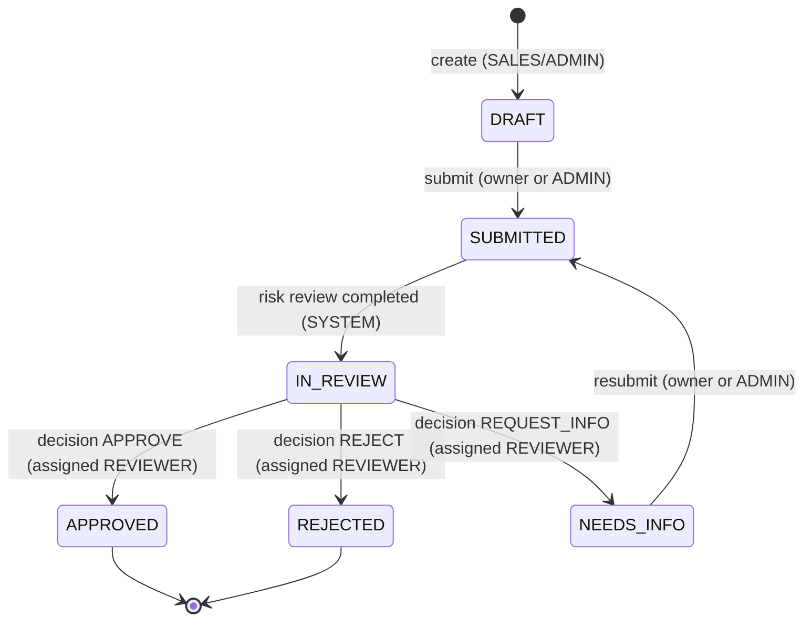

# Merchant Applications API (NestJS)

Backend API for merchant application onboarding, role-based access control, and risk review pipelines built with NestJS 11, TypeORM, PostgreSQL 16, and Redis.

---

## 1. Quick Start

Run the application locally in three steps:

```bash
# 1. Prepare environment variables
cp .env.example .env
# Edit .env to supply secure values (e.g. JWT_SECRET with min 32 chars, DB passwords)

# 2. Start PostgreSQL, Redis, and Adminer background containers
docker compose up -d postgres redis adminer

# 3. Run database migrations, seed initial users, and start the development server
npm run migration:run && npm run seed && npm run start:dev
```

The server boots at `http://localhost:3000`. 
- OpenAPI Swagger documentation: `http://localhost:3000/docs`
- Database UI (Adminer): `http://localhost:8080` (System: `PostgreSQL`, Server: `postgres`, Username/Password/Database from `.env`)

---

## 2. Architecture Overview

The system is organized into modular features with strict boundaries:

- **`src/config/`**: Type-safe configuration service with fail-fast Joi schema validation at boot.
- **`src/database/`**: TypeORM 0.3 DataSource, migration files, and idempotent user seeding.
- **`src/health/`**: `GET /health` endpoint monitoring real-time PostgreSQL and Redis TCP connectivity.
- **`src/common/`**: Shared filters, parameter decorators, and TypeScript interfaces. Feature modules do not bleed into `common/`.
- **`src/auth/`**: Custom JWT authentication, Argon2id hashing, timing-safe credential verification, and guards.
- **`src/users/`**: User entity with UUID primary keys, role enums, and repository helpers.
- **`src/applications/`**: Domain authorization policy (`ApplicationPolicy`) enforcing object-level permissions and database query scoping.

### Cross-Cutting Concerns
- **Security Headers**: [Helmet](https://helmetjs.github.io/) configured globally.
- **Input Validation**: Global `ValidationPipe` with `whitelist: true` and `forbidNonWhitelisted: true` protecting against mass-assignment attacks.
- **Unified Error Handling**: `AllExceptionsFilter` converts all exceptions into a consistent shape (`{ statusCode, error, message, path, timestamp }`), maps PostgreSQL unique constraint violations (`23505`) to `409 Conflict`, and conceals internal SQL/stack trace details.
- **Structured Logging**: `nestjs-pino` declarative logging with automatic redaction of sensitive headers and tokens, and exclusion of request bodies.
- **Rate Limiting**: `@nestjs/throttler` guarding endpoints, including strict limits on `POST /auth/login` (5 requests per minute per IP).

---

## 3. Security & Authentication Architecture

### 3.1 The Three-Layer Authorization Model

| Layer | Responsibility | Component | Failure Code |
|---|---|---|---|
| **Layer 1: Authentication** | "Who are you?" Validates JWT signature, claims, and active account status in DB. | `JwtAuthGuard` (global `APP_GUARD`) | `401 Unauthorized` |
| **Layer 2: Role Gate** | "Is your role permitted on this route?" Checks route `@Roles()` metadata. | `RolesGuard` (global `APP_GUARD`) | `403 Forbidden` |
| **Layer 3: Object-Level Authorization** | "Are you allowed to access or mutate this specific record?" | `ApplicationPolicy` & SQL Query Scoping | `404 Not Found` (SALES isolation) / `403 Forbidden` |

### 3.2 Design Decisions: No Passport and No Better Auth
- **No Passport**: Avoids unnecessary middleware abstraction overhead and session baggage. Implementing direct NestJS guards provides full visibility over the execution chain, algorithm pinning, and error responses.
- **No Better Auth**: Prevents external framework assumptions and ensures complete adherence to the enterprise TypeORM + PostgreSQL schema and test harness.

### 3.3 Security Trade-offs
- **Short-Lived Access Tokens Without Refresh Tokens (Assumption A6)**: Tokens expire after 15 minutes. This eliminates server-side token storage, token replay vulnerabilities, and distributed revocation synchronization, at the trade-off of requiring clients to re-authenticate when tokens expire.
- **HS256 Symmetric Signing vs Asymmetric Keys (RS256/ES256)**: HS256 is pinned explicitly on both signing and verification (protecting against algorithm downgrade and confusion attacks). For a monolithic internal service, symmetric secrets offer high performance and operational simplicity.
- **Database Lookup Per Request (Assumption A7)**: Roles and active status are resolved against the database on every authenticated request rather than trusted from the JWT claims. This guarantees immediate enforcement when a user is deactivated or their role is modified, costing a single indexed primary key lookup per request.

### 3.4 Sensitive Data & Protection at Rest
In a production deployment, sensitive compliance and personal data require **field-level encryption at rest** (e.g., using AES-256-GCM with envelope encryption via AWS KMS or HashiCorp Vault):
- **Applicant & Identity Fields**: Tax ID / EIN / SSN, Date of Birth, Passport / Driver's License Number.
- **Financial & Settlement Fields**: Bank Account Number, Routing / ABA Number, IBAN.
- **Personal Contact Details**: Primary phone number, owner home address, personal email.

Masking is enforced in transit and logs:
- Request bodies are excluded from access logs.
- Sensitive fields (`req.headers.authorization`, `req.headers.cookie`, `password`, `*.token`, `*.passwordHash`) are redacted with `[REDACTED]`.

---

## 4. Merchant Application Lifecycle

### 4.1 Lifecycle Design & Two Independent Axes
The lifecycle distinguishes two orthogonal axes:
- **`status` (Process / Workflow)**: Where the merchant is in the human onboarding flow (`DRAFT`, `SUBMITTED`, `IN_REVIEW`, `NEEDS_INFO`, `APPROVED`, `REJECTED`).
- **`riskStatus` (Automated Verification)**: What the automated risk underwriting system has evaluated (`NOT_STARTED`, `PENDING`, `CLEAR`, `FLAGGED`, `FAILED`).



### 4.2 State Transitions & Editable Invariants
- `DRAFT` and `NEEDS_INFO` are editable via `PATCH /applications/:id`.
- `SUBMITTED`, `IN_REVIEW`, `APPROVED`, and `REJECTED` are locked against edits.
- `APPROVED` and `REJECTED` are terminal states (immutable).
- Reviewer assignment is allowed only in `SUBMITTED`, `IN_REVIEW`, and `NEEDS_INFO`.

### 4.3 Authorization & Check Order
To prevent enumeration vulnerabilities and enforce clean state semantics:
1. **Authentication** -> 401 Unauthorized
2. **Role gate (`@Roles`)** -> 403 Forbidden
3. **Database visibility scoping (SALES isolated to `createdById`)** -> 404 Not Found
4. **Object-level policy (e.g. assigned reviewer check)** -> 403 Forbidden (Non-assigned reviewer or ADMIN attempting to decide)
5. **State machine transition validity** -> 409 Conflict (`INVALID_STATE_TRANSITION` / `APPLICATION_NOT_EDITABLE`)
6. **Business input validation (reviewer eligibility, decision comments)** -> 400 Bad Request

### 4.4 Asynchronous Risk Review & Three-Layer Idempotency
Risk reviews are dispatched asynchronously via BullMQ on the `risk-review` queue. To ensure safety across at-least-once deliveries:
1. **Queue Level**: `jobId = risk-review-${applicationId}-${submissionNumber}` deduplicates enqueue requests.
2. **Database Level**: `UNIQUE (application_id, submission_number)` constraint on `risk_reviews`.
3. **Worker Level**: Checks if `status === 'COMPLETED'` or if `submission_number` is stale prior to processing, and acquires row locks before persisting results.

*Reliability Trade-off*: BullMQ jobs are enqueued after database transaction commit to avoid worker races before data visibility. A bootstrap recovery service (`RiskReviewRecoveryService`) re-enqueues orphaned reviews. In enterprise high-throughput environments, a **Transactional Outbox Pattern** with CDC (e.g., Debezium) would replace enqueue-after-commit.

### 4.5 Audit Trail & Sensitive Data Protection
- **Allowlist-Based Sanitizer**: Deny-by-default sanitization strips unknown fields, hashes, passwords, and tokens.
- **Data Masking**:
  - `businessTaxId` is write-only, returned as masked `*****0001`.
  - `ownerDateOfBirth` is write-only, never returned by the API.
  - Emails and phone numbers are masked in audit logs (`o***@example.com`, `*********0000`).
- **Append-Only Database Trigger**: PostgreSQL row trigger blocks any `UPDATE` or `DELETE` on `audit_logs`.
- **Field-Level Encryption (Future Work)**: In production, high-sensitivity fields (`businessTaxId`, `ownerDateOfBirth`) require envelope encryption using AES-256-GCM backed by KMS/Vault.

---

## 5. Architectural Decisions and Log

All explicit architectural assumptions and deviations are recorded in [`docs/DECISIONS.md`](docs/DECISIONS.md).

---

## 6. Testing

The project uses Jest for unit tests and Supertest against real PostgreSQL and Redis instances for end-to-end integration tests:

```bash
# Run unit tests
npm test

# Run end-to-end test suite (against real test DB)
npm run test:e2e

# Run linter
npm run lint

# Build production bundle
npm run build
```

---

## 7. Future Work (Documented Extensions)

- **Post-approval states**: `BOARDING`, `ACTIVE`, `SUSPENDED`.
- **Beneficial owners**: KYC collection and aggregated scoring for all owners with >= 25% equity.
- **Transactional Outbox Pattern**: Full outbox table with polling or Postgres CDC.
- **KMS-backed Field-Level Encryption**: Automated AES-256-GCM encryption/decryption hooks.

